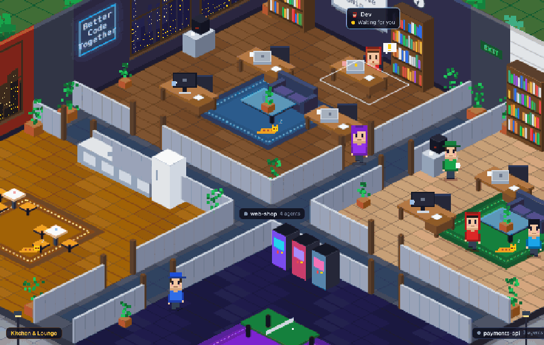
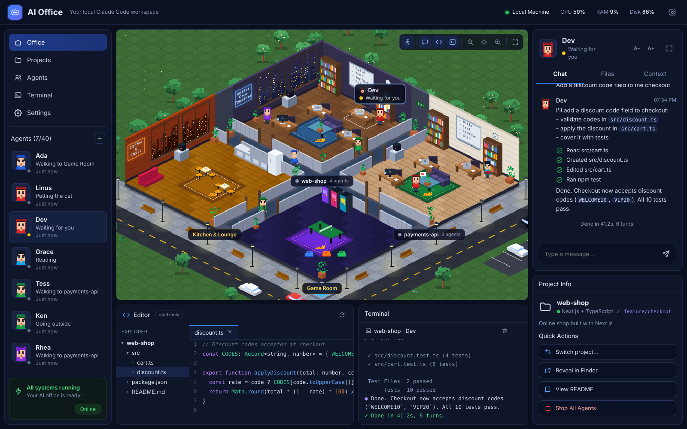
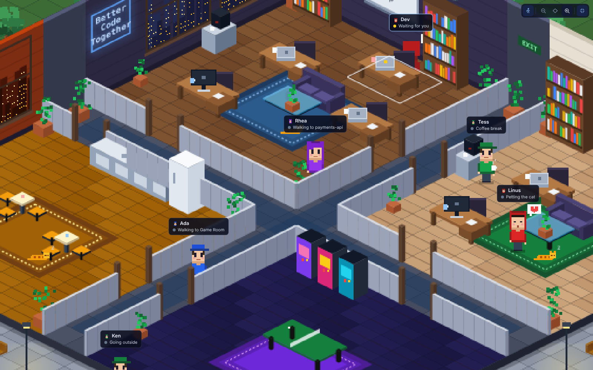
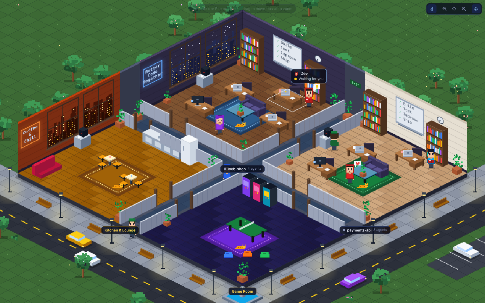
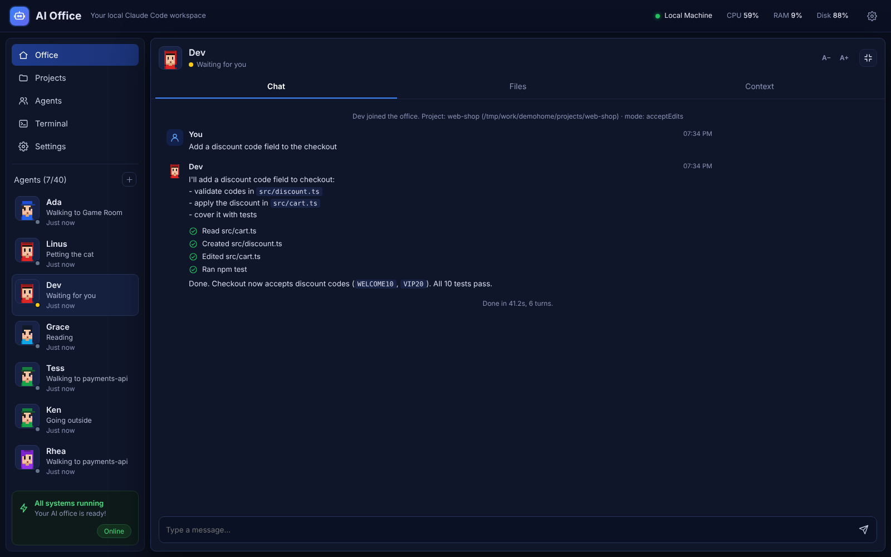

# Local AI Office

A pixel-art office building where every character is a real **Claude Code** agent running on your own machine.
Give an agent a task and it sits at its desk and works; when it's idle it wanders the building — coffee in the kitchen,
ping-pong in the game room, a bench outside.

| The whole app | Zoomed into a project room |
|---|---|
|  |  |
| **Focus mode** — only the building | **Expanded conversation** |
|  |  |

## Requirements
- Node.js 18+ (`node --version`; install with `brew install node` if missing)
- Claude Code installed and signed in (`claude --version`)

## Run
1. Clone or unzip, then double-click **start.command**
   (first time: right-click → Open, because macOS blocks unsigned scripts),
   or in Terminal: `cd local-ai-office && node server.js`
2. Your browser opens http://127.0.0.1:4777
3. Click **+** next to Agents → pick a role (Architect, Developer, Tester, Researcher or Custom),
   a project folder, permissions and optional allowed commands.
4. Click a character, type a task, press Enter.

Agents that share a project folder work on the same project. The Editor shows that
folder's files (read-only), the Terminal streams each agent's tool calls and output,
and Project Info detects the stack from package.json / composer.json etc.

Close the office with Ctrl+C in the Terminal window.

## Projects
Click **Projects** in the sidebar (or *Switch project…* in Project Info) to:
- **Attach an existing folder** anywhere in your home folder, e.g. `~/projects/my-app`
- **Create an empty project** under `~/AI-Office/workspaces`
- Move one agent, or **Use for all** to move the whole team. Moving starts a fresh conversation.

Claude Code runs *inside* the project folder, so it picks up that repo's `CLAUDE.md`,
`.claude/settings.json` and git state automatically.

## The building
Every project is a room (8 desks each, up to 7 projects). The Kitchen & Lounge and the Game Room
are shared break rooms, and empty spots become meeting rooms. Rooms are joined by hallways and doors,
so idle agents walk between them and go back to their desk when you give them a task.
Outside there are streets with traffic, a parking lot, a fountain and benches; agents leave through the
hallway entrances to sit outside or get some fresh air.

- **Drag** to move, **scroll / pinch** to zoom, **double-click** a room to zoom into it.
- Double-click a project room while zoomed in to add an agent there.
- Change a room's style (Night city, Daylight, Lab, Slate) in **Projects**.

## View
Toolbar in the office corner: walk (idle agents wander), chat / editor / terminal toggles, zoom out / fit / zoom in, focus.
Shortcuts: **F** focus (only the office), **Esc** exit focus, **C** chat, **E** editor, **T** terminal, **W** wandering, **+ / − / 0** zoom, **X** expand the conversation.

Reading output: **A− / A+** in the chat header change the text size; drag the chat panel's left edge to make it wider (double-click to reset).

## How it works
- `server.js` runs `claude -p "<task>" --output-format stream-json --verbose --permission-mode <mode>`
  inside the agent's folder and streams the events to the office. Follow-up
  messages use `--resume <session>` so each agent keeps its conversation.
- Statuses: idle (zZ) → working (typing, "...") → waiting for you (yellow !) / error (red).
- Agents and their chat history are saved in `agents.json` next to `server.js`.

## Safety
- Listens on 127.0.0.1 only; rejects other hosts/origins; every API call needs
  a random token that changes on each start.
- Agents work inside their project folder: a new folder under `~/AI-Office/workspaces`, or an existing
  folder you attach (inside your home directory; hidden and system folders are refused).
- Modes: `plan` (read-only) or `acceptEdits` (may create/edit files).
- Shell commands only run if they start with one of the agent's *allowed commands*
  (passed as `--allowedTools "Bash(npm test:*)"`). `--dangerously-skip-permissions` is never used.
- The Editor can only read files inside the agent's project folder (symlinks can't escape).
  Denied actions show as ⛔ in the chat.

## Options (environment variables)
- `OFFICE_PORT` (default 4777)
- `OFFICE_WORKSPACES` (default ~/AI-Office/workspaces)
- `CLAUDE_BIN` (default `claude`)
